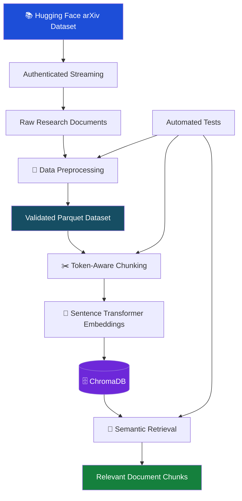
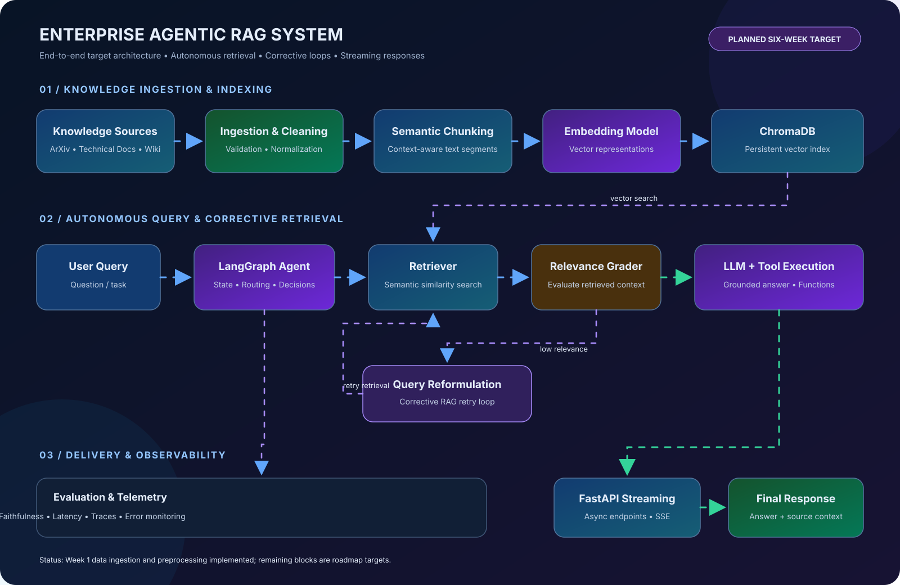
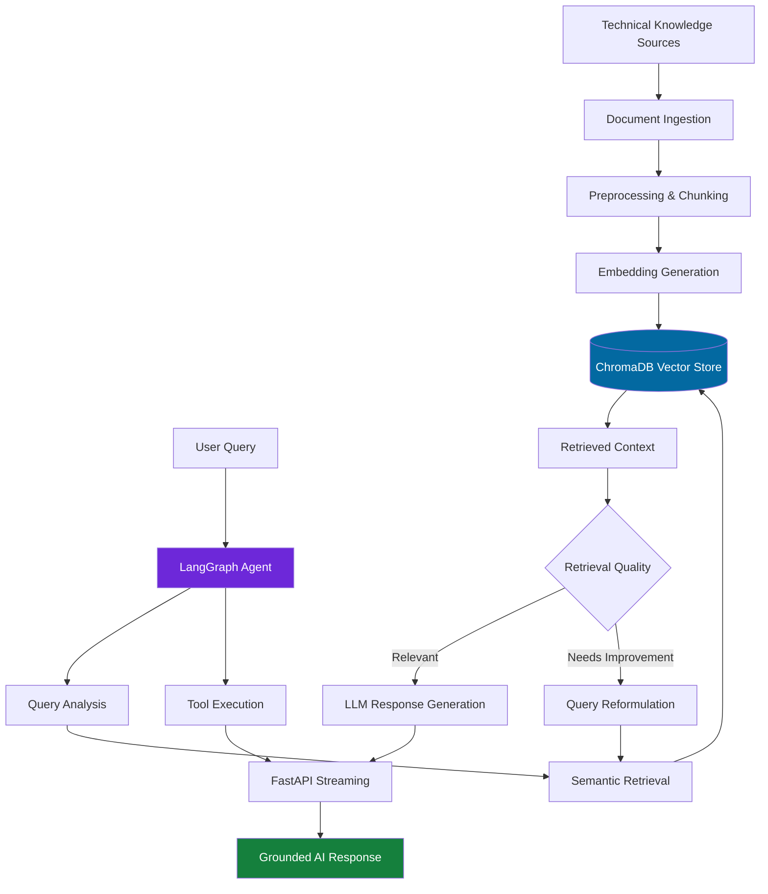

# ⚡ Enterprise Agentic RAG System

<div align="center">


<p>
  <strong>From Research Papers to Intelligent Knowledge Retrieval</strong>
</p>

<p>
  An enterprise-oriented Agentic Retrieval-Augmented Generation system
  built through data engineering, semantic search, vector databases,
  and autonomous AI workflows.
</p>

<br/>

<a href="https://github.com/Chaman4211/enterprise-agentic-rag-system">
  
</a>


<br/><br/>

[](https://www.python.org/)
[](https://pytorch.org/)
[](https://huggingface.co/)
[](https://www.trychroma.com/)
[](https://www.sbert.net/)
[](https://ubuntu.com/)
[](https://git-scm.com/)

<br/>


</div>

## 🧠 01. Project Overview

The **Enterprise Agentic RAG System** is an AI engineering project developed as part of **Parallax Labs Cohort 4 — AI/ML Engineer Internship, Track B: Autonomous Agentic Systems**.

The objective is to build an enterprise-oriented Retrieval-Augmented Generation system capable of retrieving relevant information from a technical knowledge base and progressively supporting multi-step agent workflows.

Instead of depending entirely on a language model's internal knowledge, the system uses an external document knowledge base to retrieve relevant information and provide grounded context for AI-generated responses.

The development follows a six-week engineering roadmap, beginning with large-scale data ingestion and progressing toward semantic retrieval, agent orchestration, evaluation, and deployment.

### 🎯 Core Objectives

- Build a reliable technical-document ingestion pipeline.
- Process thousands of research papers.
- Implement token-aware semantic document chunking.
- Generate dense vector embeddings.
- Store and retrieve document chunks using ChromaDB.
- Benchmark embedding and retrieval performance.
- Develop autonomous workflows using LangGraph.
- Implement retrieval correction and query reformulation.
- Expose the system through a streaming FastAPI service.
- Evaluate retrieval quality, response fidelity, and system performance.

---

## 📊 02. Project at a Glance

<div align="center">

| Metric | Current Result |
|:---|---:|
| Research documents processed | **5,965** |
| Total corpus tokens | **94.58 Million** |
| Indexed document chunks | **527,103** |
| Embedding dimensions | **384** |
| Embedding throughput | **33.94 chunks/sec** |
| Average retrieval latency | **8.42 ms** |
| Retrieval P95 latency | **10.41 ms** |
| Automated tests passing | **32** |

<br/>


</div>

---

## 🗺️ 03. Development Progress

<div align="center">

| Milestone | Status |
|:---|:---:|
| Week 01 — Data Ingestion & Preprocessing | ✅ Completed |
| Week 02 — Semantic Chunking & Vector Database | ✅ Completed |
| Week 03 — Retrieval & RAG Development | ⏳ Upcoming |
| Week 04 — Agentic Workflows & LangGraph | ⏳ Upcoming |
| Week 05 — Evaluation & Optimization | ⏳ Upcoming |
| Week 06 — Integration & Deployment | ⏳ Upcoming |

<br/>


<sub>Two of six development milestones completed.</sub>

</div>

---

## 🏗️ 04. System Architecture

### Current Implementation — Weeks 1 and 2

The current implementation includes document collection, preprocessing, token-aware chunking, embedding generation, persistent vector storage, and semantic retrieval.



### Target Architecture — Complete Six-Week System

The following architecture represents the planned end-to-end system. Agent orchestration, corrective retrieval, and the streaming API are future milestones, not completed features.

<div align="center">



<sub>Target architecture across the six-week development roadmap.</sub>

</div>



---

## 📚 05. Week 1 — Data Ingestion & Preprocessing

<details open>
<summary><strong>✅ Completed — Data Foundation</strong></summary>

### Dataset Source

**Common Pile — arXiv Papers**

[Explore the Hugging Face dataset](https://huggingface.co/datasets/common-pile/arxiv_papers)

| Property | Details |
|:---|:---|
| Provider | Hugging Face Datasets |
| Dataset | `common-pile/arxiv_papers` |
| Split | `train` |
| Collection method | Authenticated streaming |
| Raw format | Compressed JSONL |
| Processed format | Apache Parquet |
| Raw records | 6,000 |
| Accepted records | 5,965 |

### Processing Results

| Metric | Verified Result |
|:---|---:|
| Raw documents collected | 6,000 |
| Unique raw document IDs | 6,000 |
| Processed documents | 5,965 |
| Filtered documents | 35 |
| Invalid JSON records | 0 |
| Duplicate processed IDs | 0 |
| Missing text records | 0 |
| Non-English processed records | 0 |

### Preprocessing Implementation

Location: `src/preprocessing.py`

Implemented operations:

1. Unicode normalization using NFKC.
2. HTML markup removal.
3. Script and style element removal.
4. Whitespace normalization.
5. English-language detection and filtering.
6. Minimum text length validation.
7. Metadata preservation.
8. Efficient language detection using the first 1,000 characters.
9. Preservation of LaTeX mathematical expressions.

### Output Dataset

`data/processed/clean_corpus.parquet`

| Column | Description |
|:---|:---|
| `id` | Original document ID |
| `text` | Cleaned document text |
| `source` | Document source |
| `created` | Original creation information |
| `added` | Dataset addition information |
| `language` | Detected language |
| `text_length` | Cleaned text length |
| `license` | Original license information |
| `url` | Available document URL |
| `metadata_json` | Preserved metadata |

</details>

---

## ✂️ 06. Week 2 — Semantic Chunking & Vector Database

<details open>
<summary><strong>✅ Completed — Full Corpus Indexed and Benchmarked</strong></summary>

Week 2 transforms the processed research corpus into a searchable vector database.

### 6.1 Token Length Profiling

Before chunking, all 5,965 documents were analyzed using the tokenizer associated with:

[all-MiniLM-L6-v2](https://huggingface.co/sentence-transformers/all-MiniLM-L6-v2)

| Metric | Result |
|:---|---:|
| Documents profiled | 5,965 |
| Total tokens | 94,581,270 |
| Mean tokens/document | 15,856 |
| Median tokens/document | 10,696 |
| 75th percentile | 18,711 |
| 90th percentile | 30,372 |
| 95th percentile | 42,686 |
| 99th percentile | 76,110 |
| Maximum document length | 1,097,032 |
| Documents exceeding 254 content tokens | 99.93% |

This profiling established the need for token-aware chunking rather than embedding entire documents directly.

### 6.2 Token-Aware Chunking

Implementation: `src/chunking.py`

| Configuration | Value |
|:---|---:|
| Chunk size | 220 tokens |
| Overlap | 40 tokens |
| Stride | 180 tokens |
| Model maximum sequence length | 256 tokens |
| Embedding dimension | 384 |

Features:

- Hugging Face fast-tokenizer offsets.
- Original-text slicing instead of decoding token IDs.
- Overlapping chunks for contextual continuity.
- Preservation of punctuation and mathematical expressions.
- Chunk indices and token-position metadata.
- Token-count validation.

### 6.3 Embedding Generation

Model: `sentence-transformers/all-MiniLM-L6-v2`

| Benchmark Metric | Result |
|:---|---:|
| Benchmark sample | 256 chunks |
| Warm-up chunks | 8 |
| Measured chunks | 248 |
| Batch size | 16 |
| Embedding duration | 7.31 seconds |
| Throughput | 33.94 chunks/second |
| Estimated full-corpus embedding time | ~4.31 hours |

The full-corpus time is an extrapolation from the sample benchmark, not a measured end-to-end ingestion duration.

### 6.4 Persistent Vector Database

Implementation: `src/vector_store.py`

| Configuration | Value |
|:---|:---|
| Vector database | ChromaDB |
| Collection | `agentic_rag_chunks` |
| Distance metric | Cosine |
| Embedding model | all-MiniLM-L6-v2 |
| Embedding dimensions | 384 |
| Persistence | Local disk |
| Database directory | `data/chroma/` |

### 6.5 Full Corpus Ingestion

Implementation: `scripts/ingest_vector_store.py`

### 📊 Verified Ingestion Results

| Metric | Result |
|:---|---:|
| Documents ingested | 5,965 |
| Total indexed chunks | 527,103 |
| Average chunks/document | 88.37 |
| Ingestion duration | 300.11 minutes |
| Peak resident memory | ~2.19 GB |
| Peak memory high-water mark | ~2.32 GB |

The complete corpus was embedded and persisted in ChromaDB.

**Reliability features:**

- Deterministic chunk identifiers.
- Resumable ingestion.
- Progress checkpointing.
- Atomic checkpoint writes.
- Recovery from partially ingested documents.
- Persistent vector storage.

### 6.6 Semantic Retrieval

Implementation: `src/retrieval.py`

The retrieval pipeline:

1. Accepts a natural-language query.
2. Generates a query embedding using the same embedding model.
3. Searches ChromaDB using cosine distance.
4. Returns the most relevant document chunks.
5. Includes document metadata, distance, and similarity score.

Similarity is calculated as `1 - distance`. It is a ranking signal, not a calibrated probability.

### 6.7 Retrieval Benchmark

Ten research-related queries were evaluated with three repetitions each.

| Metric | Result |
|:---|---:|
| Unique queries | 10 |
| Repetitions per query | 3 |
| Measured operations | 30 |
| Average latency | 8.42 ms |
| Median latency | 8.12 ms |
| P95 latency | 10.41 ms |
| Minimum latency | 7.20 ms |
| Maximum latency | 10.45 ms |

Latency includes query embedding and ChromaDB search. Model loading is excluded.

**Retrieval observations:**

- Stronger matches were observed for reinforcement learning, speech recognition, word embeddings, information retrieval, and question answering.
- Transformer self-attention and graph neural network queries showed weaker results.
- GAN-related retrieval needs improvement.
- Some queries returned multiple chunks from the same document.

These results establish a baseline for future retrieval optimization.

### 6.8 Week 2 Deliverables

```text
src/
├── preprocessing.py
├── chunking.py
├── vector_store.py
└── retrieval.py

scripts/
├── profile_token_lengths.py
├── estimate_chunks.py
├── benchmark_embeddings.py
├── ingest_vector_store.py
├── test_live_retrieval.py
└── benchmark_retrieval.py

tests/
├── test_preprocessing.py
├── test_chunking.py
└── test_retrieval.py
```

</details>

---

## ⚡ 07. Performance Benchmarks

<div align="center">

### Vector Database


### Retrieval Performance


### Embedding Performance


</div>

### Execution Environment

- Python 3.11.
- CPU-compatible PyTorch.
- Sentence Transformers.
- ChromaDB.
- Ubuntu Linux.

The pipeline and benchmarks were executed successfully without requiring dedicated GPU acceleration.

---

## 🧪 08. Testing & Validation

The project contains automated tests for preprocessing, chunking, and retrieval.

### Latest Complete Test Run

<div align="center">


```text
32 passed in 9.46s
```

</div>

Run the complete test suite:

```bash
python -m pytest -q
```

Run with detailed output:

```bash
python -m pytest -v
```

Compile project modules:

```bash
python -m compileall -q src scripts tests
```

### Test Coverage

- Text preprocessing and validation.
- Unicode and HTML handling.
- Metadata preservation.
- Token-aware chunk generation.
- Overlap and token offsets.
- Empty and invalid chunk inputs.
- Semantic retrieval validation.
- Query and top-k validation.

---

## 💻 09. Development Environment

### Verified Dependencies

| Component | Version |
|:---|:---|
| Python | 3.11.18 |
| PyTorch | 2.15.0+cpu |
| pandas | 3.1.1 |
| PyArrow | 26.0.1 |
| Sentence Transformers | 6.3.0 |
| ChromaDB | 1.5.9 |
| Transformers | 5.23.0 |
| Pytest | 9.2.0 |

The project uses Conda for environment management and CPU-compatible machine learning dependencies.

---

## 🚀 10. Getting Started

### Prerequisites

- Ubuntu/Linux or another supported operating system.
- Python 3.11.
- Conda.
- Git.
- Hugging Face account for dataset collection.
- Sufficient disk space for local datasets and vector storage.

### 10.1 Clone the Repository

```bash
git clone https://github.com/Chaman4211/enterprise-agentic-rag-system.git

cd enterprise-agentic-rag-system
```

### 10.2 Create the Environment

```bash
conda create -n agentic-rag python=3.11 -y

conda activate agentic-rag
```

### 10.3 Install Dependencies

```bash
python -m pip install --upgrade pip

python -m pip install -r requirements.txt
```

### 10.4 Run Tests

```bash
python -m pytest -q
```

### 10.5 Explore the Week 2 Pipeline

Profile token lengths:

```bash
python scripts/profile_token_lengths.py
```

Estimate chunk counts:

```bash
python scripts/estimate_chunks.py
```

Benchmark embeddings:

```bash
python scripts/benchmark_embeddings.py
```

Run semantic retrieval:

```bash
python scripts/test_live_retrieval.py
```

Benchmark retrieval:

```bash
python scripts/benchmark_retrieval.py
```

**Important:** Full-corpus ingestion has already been completed in the development environment. The local ChromaDB database is stored in `data/chroma/` and is excluded from Git. Do not rerun full ingestion unnecessarily.

### 10.6 Dataset Collection and Preprocessing

For a fresh environment, the original Week 1 pipeline includes:

```bash
hf auth login
```

```bash
python scripts/collect_papers.py
python scripts/preprocess_dataset.py
python scripts/validate_dataset.py
```

The dataset collection and preprocessing scripts are retained as part of the original pipeline.

---

## 📁 11. Repository Structure

```text
enterprise-agentic-rag-system/
│
├── data/
│   ├── raw/
│   ├── processed/
│   │   └── clean_corpus.parquet
│   └── chroma/                     # Local, Git-ignored database
│
├── scripts/
│   ├── collect_papers.py
│   ├── collect_more_papers.py
│   ├── ingest_dataset.py
│   ├── preprocess_dataset.py
│   ├── validate_dataset.py
│   ├── verify_env.py
│   ├── profile_token_lengths.py
│   ├── estimate_chunks.py
│   ├── benchmark_embeddings.py
│   ├── ingest_vector_store.py
│   ├── test_live_retrieval.py
│   └── benchmark_retrieval.py
│
├── src/
│   ├── __init__.py
│   ├── preprocessing.py
│   ├── chunking.py
│   ├── vector_store.py
│   └── retrieval.py
│
├── tests/
│   ├── __init__.py
│   ├── test_preprocessing.py
│   ├── test_chunking.py
│   └── test_retrieval.py
│
├── notebooks/
├── docs/
│   └── architecture-flow.svg
│
├── .env.example
├── .gitignore
├── requirements.txt
└── README.md
```

*Generated datasets, vector databases, checkpoints, and benchmark reports are kept locally and excluded from Git.*

---

## 🛠️ 12. Technology Stack

<div align="center">

| Category | Technology |
|:---|:---|
| Programming Language | Python 3.11 |
| Data Engineering | Pandas, PyArrow |
| Dataset Ingestion | Hugging Face Datasets |
| NLP & Tokenization | Hugging Face Transformers |
| Deep Learning | PyTorch |
| Embeddings | Sentence Transformers |
| Vector Database | ChromaDB |
| Document Storage | Apache Parquet |
| Testing | Pytest |
| Environment Management | Conda |
| Version Control | Git & GitHub |
| Operating System | Ubuntu Linux |

</div>

### Planned Technologies

| Technology | Planned Purpose |
|:---|:---|
| LangGraph | Stateful agent orchestration |
| LLM Integration | Context-aware response generation |
| Function Calling | Tool execution |
| FastAPI | Streaming API |
| Evaluation Framework | Retrieval and response evaluation |

---

## 🔐 13. Data Integrity & Licensing

The source dataset contains multiple license types. The collected corpus must not be considered entirely public domain.

The preprocessing pipeline preserves original license information in document metadata.

Before redistributing or publishing an individual document, its original license must be checked.

Project data-handling practices:

- Raw datasets are stored locally.
- Processed datasets are stored locally.
- Vector database files are excluded from Git.
- Environment secrets are excluded from Git.
- Original document metadata is preserved.
- Dataset validation is performed before downstream processing.

---

## 🗺️ 14. Six-Week Engineering Roadmap

| Week | Milestone | Main Deliverables | Status |
|:---:|:---|:---|:---:|
| 01 | Data Foundation | Ingestion, preprocessing, validation | ✅ |
| 02 | Semantic Chunking & Vector DB | Chunking, embeddings, ChromaDB, retrieval baseline | ✅ |
| 03 | Retrieval & RAG Development | Retrieval improvements and RAG pipeline | ⏳ |
| 04 | Agentic Workflows | LangGraph, tool calling, state management | ⏳ |
| 05 | Evaluation & Optimization | Query rewriting, quality evaluation, performance | ⏳ |
| 06 | Integration & Deployment | FastAPI, telemetry, final benchmarks and launch | ⏳ |

### Completed Work

- [x] Git repository initialized.
- [x] Python 3.11 environment configured.
- [x] Dataset collection implemented.
- [x] 6,000 research papers collected.
- [x] Data preprocessing implemented.
- [x] 5,965 documents validated.
- [x] Token length profiling completed.
- [x] Token-aware chunking implemented.
- [x] Embedding benchmark completed.
- [x] ChromaDB integration implemented.
- [x] 527,103 chunks indexed.
- [x] Resumable ingestion and checkpoint recovery implemented.
- [x] Semantic retrieval implemented.
- [x] Ten-query retrieval benchmark completed.
- [x] 32 automated tests passing.

### Upcoming Work

- [ ] Improve retrieval relevance.
- [ ] Implement RAG response generation.
- [ ] Integrate LLMs.
- [ ] Build LangGraph agent workflows.
- [ ] Implement tool and function calling.
- [ ] Add corrective retrieval and query reformulation.
- [ ] Develop FastAPI streaming endpoints.
- [ ] Evaluate response quality and system reliability.
- [ ] Complete final integration and deployment.

---

## 🧩 15. Engineering Principles

| Principle | Implementation |
|:---|:---|
| Reproducibility | Deterministic chunk identifiers and repeatable benchmarks |
| Scalability | Batch processing and persistent vector storage |
| Reliability | Checkpoint-based ingestion and recovery |
| Observability | Latency, throughput, and memory measurements |
| Maintainability | Modular source code and automated tests |
| Resource Awareness | CPU-compatible and memory-conscious execution |
| Data Integrity | Metadata preservation and validation |

---

## 👨‍💻 16. Developer

<div align="center">


### Chaman Afzaal

**Software Engineering Graduate | Data Engineering & AI Enthusiast**

Interested in building practical AI systems, data pipelines, semantic search, and intelligent applications.

<br/>

<a href="https://github.com/Chaman4211">
  
</a>

<br/><br/>

**Program:** Parallax Labs Cohort 4

**Track:** B — Autonomous Agentic Systems

</div>

---

## 📜 License

This project is developed for educational, research, and engineering purposes.

A formal repository license will be added when the project licensing is finalized.

---

<div align="center">


### From Raw Research Data to Autonomous Intelligence.

**One milestone at a time.**


</div>
