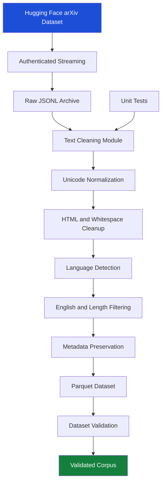
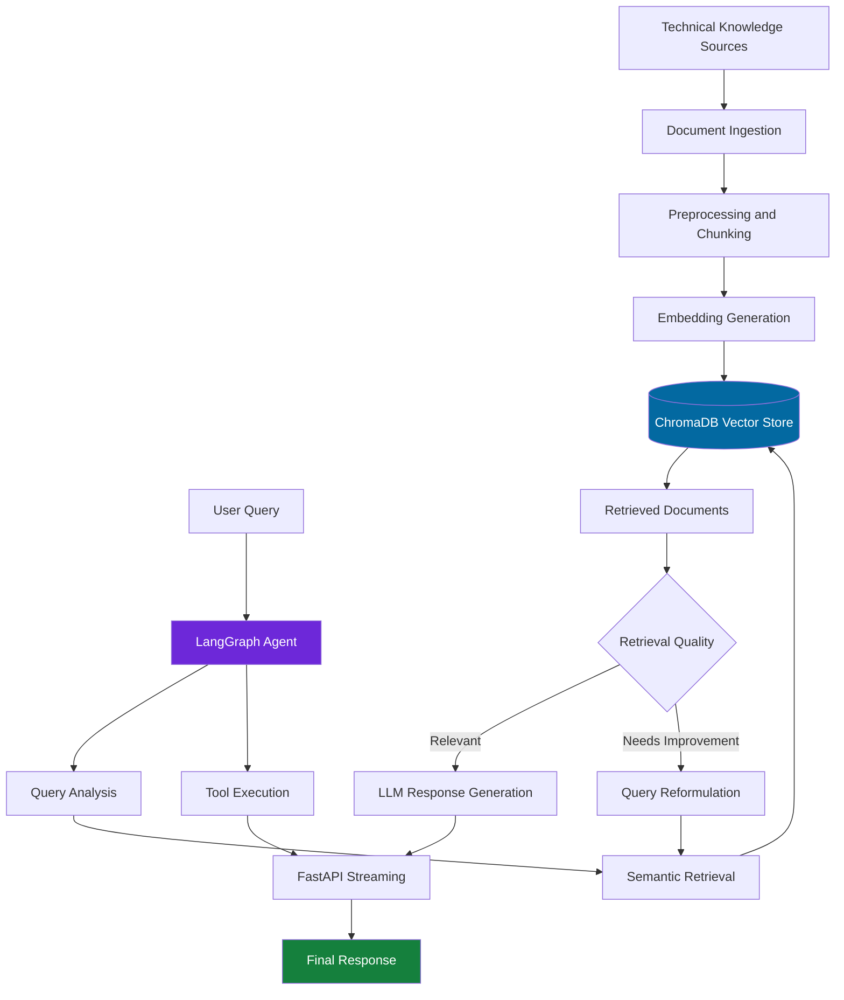

# ⚡ Agentic RAG System

<div align="center">


<p>
  <strong>An Autonomous Agentic RAG System for Technical Knowledge Retrieval</strong>
</p>

<p>
  Building an intelligent document retrieval and reasoning system
  through modular data engineering, semantic search and autonomous agents.
</p>

<br/>

<a href="https://github.com/Chaman4211/agentic-rag-system">
  
</a>


<br/><br/>


</div>

## 🧠 01. Project Overview

The **Agentic RAG System** is an AI engineering project developed as part of the **Parallax Labs Cohort 4 — AI/ML Engineer Internship, Track B: Autonomous Agentic Systems**.

The objective is to develop an enterprise-oriented Retrieval-Augmented Generation system capable of retrieving relevant information from a technical knowledge base and executing multi-step agent workflows.

Unlike a basic question-answering application, the planned system will combine document processing, semantic retrieval, tool execution, stateful agent orchestration and retrieval correction.

Development follows a six-week engineering roadmap. Week 1 establishes the data foundation required by the later components.

## 🎯 02. Project Objectives

- Build a reliable technical-document ingestion pipeline.
- Process and validate more than 5,000 real-world documents.
- Generate clean, structured data for downstream AI processing.
- Implement semantic chunking and vector indexing.
- Develop autonomous workflows using LangGraph.
- Implement retrieval correction and query reformulation.
- Expose the system through a streaming FastAPI service.
- Evaluate retrieval quality, response fidelity and system performance.

## 📊 03. Week 1 — Data Foundation

<div align="center">

| Metric | Verified Result |
| :--- | ---: |
| 📚 Raw documents collected | **6,000** |
| 🆔 Unique raw document IDs | **6,000** |
| ✅ Processed documents | **5,965** |
| 🧹 Filtered documents | **35** |
| ❌ Invalid JSON records | **0** |
| 🌐 Non-English processed records | **0** |
| 🧪 Unit tests passed | **10 / 10** |

</div>

### Dataset Source

**Common Pile — arXiv Papers**

[Explore the Hugging Face dataset](https://huggingface.co/datasets/common-pile/arxiv_papers)

| Property | Details |
| :--- | :--- |
| Provider | Hugging Face Datasets |
| Dataset | `common-pile/arxiv_papers` |
| Split | `train` |
| Collection method | Authenticated streaming |
| Raw format | Compressed JSONL |
| Processed format | Apache Parquet |
| Raw records | 6,000 |
| Accepted records | 5,965 |

The original document text and available metadata are preserved during processing.

### Dataset Processing Results

```text
Raw documents                 6,000
                              -------
Accepted documents            5,965
Filtered documents               35
Invalid JSON records              0
Duplicate processed IDs           0
Missing text                       0
Non-English records                0
Invalid metadata                   0
                              -------
Validated corpus              5,965
```

## 🏗️ 04. System Architecture

### Current Implementation — Week 1

The first milestone implements the data ingestion, preprocessing, storage and validation pipeline.



### Target Architecture — Complete Six-Week System

The following diagram describes the planned architecture, not the current Week 1 implementation.



## 🧹 05. Data Preprocessing

The preprocessing implementation is located in:

`src/preprocessing.py`

### Implemented Functions

| Function | Responsibility |
| :--- | :--- |
| `clean_text()` | Normalize and clean document text |
| `detect_language()` | Identify document language |
| `preprocess_record()` | Validate, filter and prepare document records |

### Processing Operations

1. **Unicode normalization:** Applies NFKC normalization.
2. **HTML cleaning:** Removes HTML markup.
3. **Script and style removal:** Removes script and style elements.
4. **Whitespace normalization:** Removes unnecessary whitespace.
5. **Language detection:** Detects document language.
6. **Language filtering:** Retains English-language records.
7. **Length filtering:** Rejects text shorter than 200 characters.
8. **Metadata preservation:** Retains original document metadata.

### Output Dataset

`data/processed/clean_corpus.parquet`

The processed Parquet file contains:

| Column | Description |
| :--- | :--- |
| `id` | Original document ID |
| `text` | Cleaned document text |
| `source` | Document source |
| `created` | Original creation information |
| `added` | Dataset addition information |
| `language` | Detected language |
| `text_length` | Cleaned text length |
| `license` | Original license information |
| `url` | Available document URL |
| `metadata_json` | Preserved metadata |

## 🧪 06. Testing and Validation

### Unit Testing

Test implementation:

`tests/test_preprocessing.py`

Run the tests:

```bash
python3 -m pytest -v
```

**Latest verified result: 10 tests passed.**

Test coverage includes:

- HTML removal.
- Whitespace normalization.
- Unicode normalization.
- Empty input handling.
- Invalid input handling.
- English-language detection.
- Metadata preservation.
- Missing ID rejection.
- Short-text rejection.
- Non-English document rejection.

### Dataset Validation

Validation implementation:

`scripts/validate_dataset.py`

Run:

```bash
python3 scripts/validate_dataset.py
```

Latest validation:

| Validation | Result |
| :--- | :--- |
| Expected Parquet columns | PASS |
| Total record count | 5,965 |
| Unique IDs | 5,965 |
| Missing text | 0 |
| Non-English records | 0 |
| Missing metadata | 0 |
| Invalid metadata JSON | 0 |

<details>
<summary><strong>View verified Parquet schema</strong></summary>

```text
id: string
text: string
source: string
created: string
added: string
language: string
text_length: int64
license: string
url: string
metadata_json: string
```

</details>

## 💻 07. Development Environment

### System Requirements

| Component | Requirement |
| :--- | :--- |
| Operating System | Ubuntu Linux |
| Python | 3.11 |
| Environment manager | Conda |
| Package manager | pip |
| Version control | Git |
| Dataset access | Hugging Face account |
| Hardware | CPU execution supported |

### Verified Environment

| Component | Installed Configuration |
| :--- | :--- |
| Python | 3.11.18 |
| PyTorch | 2.15.0+cpu |
| pandas | 3.1.1 |
| PyArrow | 26.0.1 |
| sentence-transformers | 6.3.0 |
| ChromaDB | 1.5.9 |
| LangGraph | 1.2.23 |
| Hugging Face Datasets | 5.2.0 |
| CUDA availability | False |
| Execution mode | CPU-only |

**Hardware note:** The current development environment uses CPU-only PyTorch. CUDA and GPU acceleration are not available in this environment. The Week 1 collection and preprocessing pipeline has been executed successfully using CPU processing.

### Environment Verification

Run:

```bash
python3 scripts/verify_env.py
```

Check installed dependencies:

```bash
python3 -m pip check
```

## 🚀 08. Installation and Local Setup

The following instructions describe how to set up the project on Ubuntu Linux.

### Step 1 — Clone the Repository

```bash
git clone https://github.com/Chaman4211/agentic-rag-system.git

cd agentic-rag-system
```

### Step 2 — Create the Conda Environment

```bash
conda create -n agentic-rag python=3.11 -y

conda activate agentic-rag
```

### Step 3 — Install Dependencies

```bash
python3 -m pip install -r requirements.txt
```

### Step 4 — Verify Environment

```bash
python3 scripts/verify_env.py

python3 -m pip check
```

### Step 5 — Authenticate with Hugging Face

If authentication is required:

```bash
hf auth login
```

### Step 6 — Collect Documents

```bash
python3 scripts/collect_papers.py
```

Expected output:

`data/raw/arxiv_papers.jsonl.gz`

The collector uses authenticated streaming and checkpointing to support collection progress.

### Step 7 — Preprocess Documents

```bash
python3 scripts/preprocess_dataset.py
```

Expected output:

`data/processed/clean_corpus.parquet`

### Step 8 — Validate the Dataset

```bash
python3 scripts/validate_dataset.py
```

### Step 9 — Run Unit Tests

```bash
python3 -m pytest -v
```

## 📁 09. Repository Structure

```text
agentic-rag-system/
│
├── data/
│   ├── raw/
│   │   └── .gitkeep
│   │
│   └── processed/
│       └── .gitkeep
│
├── scripts/
│   ├── collect_papers.py
│   ├── collect_more_papers.py
│   ├── ingest_dataset.py
│   ├── preprocess_dataset.py
│   ├── validate_dataset.py
│   └── verify_env.py
│
├── src/
│   ├── __init__.py
│   └── preprocessing.py
│
├── tests/
│   ├── __init__.py
│   └── test_preprocessing.py
│
├── notebooks/
├── docs/
│
├── .env.example
├── .gitignore
├── requirements.txt
└── README.md
```

Raw datasets, processed datasets, environment secrets and generated artifacts are excluded from Git using `.gitignore`.

## 🛠️ 10. Technology Stack

| Technology | Purpose |
| :--- | :--- |
| Python | Core development |
| Hugging Face Datasets | Dataset streaming |
| Hugging Face Hub | Dataset access and authentication |
| pandas | Data handling |
| PyArrow | Parquet storage |
| BeautifulSoup | HTML cleaning |
| langdetect | Language detection |
| pytest | Automated testing |
| PyTorch | Machine learning foundation |
| ChromaDB | Planned vector storage |
| LangGraph | Planned agent orchestration |
| FastAPI | Planned API service |

## 🛡️ 11. Data Integrity and Licensing

The source dataset contains multiple license types.

The preprocessing pipeline preserves the original license information in the document metadata.

The collected corpus must not be considered entirely public domain.

Before redistribution, publication or reuse of an individual document, its original license must be checked.

The following project practices are used:

- Raw data is stored locally.
- Processed data is stored locally.
- Dataset files are excluded from Git.
- Environment secrets are excluded from Git.
- Original document metadata is preserved.
- Dataset validation is performed before downstream use.

## 🗺️ 12. Six-Week Development Roadmap

| Week | Milestone | Planned Deliverables |
| :--- | :--- | :--- |
| 01 | Data Foundation | Ingestion, cleaning, tests and validation |
| 02 | Semantic Chunking, Embeddings & Vector DB | Semantic chunking and embedding generation |
| 03 | LLM Integration, Structured Outputs & Function Calling | ChromaDB indexing and retrieval |
| 04 | Autonomous Agent Workflows & LangGraph State Machine | LangGraph, tool calling and state management |
| 05 | Streaming API (FastAPI) & System Evaluation | Retrieval evaluation and query rewriting |
| 06 | System Architecture, Benchmarks & Launch | FastAPI streaming, telemetry and benchmarks |

### Week 1 — Completed

- [x] Git repository initialized.
- [x] Python 3.11 environment configured.
- [x] Dependencies installed and checked.
- [x] Environment verification script created.
- [x] 6,000 unique documents collected.
- [x] Modular preprocessing functions implemented.
- [x] English-language filtering implemented.
- [x] Unit tests created and passed.
- [x] 5,965 processed records generated.
- [x] Parquet dataset validated.
- [x] README documentation prepared.

### Upcoming Milestones

- [ ] Semantic document chunking.
- [ ] Embedding generation.
- [ ] ChromaDB vector indexing.
- [ ] LangGraph state machine.
- [ ] Native tool and function calling.
- [ ] Corrective RAG and query reformulation.
- [ ] FastAPI streaming endpoints.
- [ ] Evaluation and monitoring.

> **Implementation status:** Only the Week 1 data foundation is currently completed. Future roadmap components are planned and will be added incrementally.

## 👨‍💻 13. Developer

<div align="center">

**Chaman Afzaal**

AI/ML Engineer Intern

<a href="https://github.com/Chaman4211">
  
</a>

**Program:** Parallax Labs Cohort 4

**Track:** B — Autonomous Agentic Systems

</div>

---

<div align="center">


**Building intelligent systems, one milestone at a time.** ⚡

</div>
